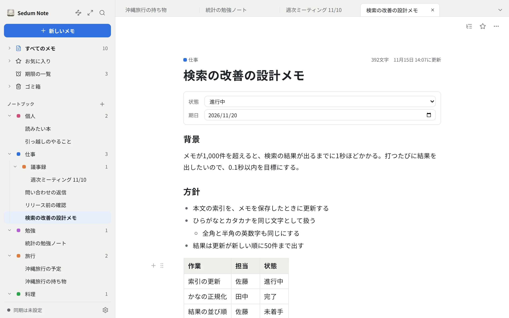

<p align="center"></p>

<h1 align="center">Sedum Note</h1>

<p align="center">メモをデバイスの中で暗号化し、自分で用意したS3互換ストレージかWebDAVサーバーで同期するメモアプリです。<br>Windows・macOS・Linux・Android・Webで使えます。</p>

<p align="center">
  <a href="https://aida0710.github.io/sedum-note/docs/">ドキュメント</a> ·
  <a href="https://aida0710.github.io/sedum-note/">Web版</a> ·
  <a href="https://github.com/aida0710/sedum-note/releases/latest">ダウンロード</a>
</p>



## 主な機能

- **エンドツーエンド暗号化の同期**: メモはデバイスの中で暗号化してから、AWS S3・Cloudflare R2・MinIOなどのS3互換ストレージか、NextcloudなどのWebDAVサーバーへ送ります。同期先には暗号文とランダムなIDだけを置きます。
- **ローカルファースト**: 同期しなくても、オフラインでも使えます。2台で同じメモを同時に編集しても、両方の変更がマージされます。
- **ブロックエディタ**: 「/」から見出し・リスト・表・コード・コールアウト・段組みを入れられます。Markdownを貼り付けると、そのまま書式になります。
- **数式・図・手書き**: LaTeXの数式（KaTeX）、Mermaidの図、手書きの線と図形、脚注を本文に入れられます。
- **添付**: 画像・ファイル・録音を添付し、PDFはメモの中でプレビューできます。書類を撮って傾きを補正した画像も入れられます。
- **リンクとバックリンク**: メモやブロックへのリンク、ブロックの埋め込み、バックリンク、グラフ表示。
- **整理**: 入れ子のノートブック、タグ、お気に入り、プロパティと、テーブル・ボードのデータベース表示。
- **検索**: メモの中の検索と置換（正規表現も可）、全メモの検索、Ctrl+Kのコマンドパレット。
- **アウトライン**: 見出しと箇条書きの折りたたみと、その部分だけを表示するズーム。
- **タブとウィンドウ**: タブ、左右に並べる表示、別のウィンドウ、フォーカスモード。
- **期限と通知**: メモとチェックリストの項目に期限を付け、OSの通知で知らせます。
- **履歴とバックアップ**: メモごとの履歴から前のバージョンに戻せます。暗号化したバックアップと、Markdown・HTML・テキストへのエクスポートがあります。
- **AI**: Claude APIやローカルのLLMとのチャットで、メモの要約や編集を頼めます。PCのアプリには、AIのクライアントからメモを操作するMCPサーバーがあります。
- **カスタマイズ**: テーマ、カスタムCSS、キーボードショートカットの変更、WebAssemblyのプラグイン。

機能ごとの説明は[ドキュメント](https://aida0710.github.io/sedum-note/docs/)にあります。

## インストール

[GitHub Releases](https://github.com/aida0710/sedum-note/releases/latest)から、OSに合うファイルをダウンロードします。

| OS | ファイル |
| --- | --- |
| Windows | `sedum-note_<バージョン>_windows-x64-setup.exe`、`.msi` |
| macOS | `sedum-note_<バージョン>_macos-universal.dmg` |
| Linux | `.AppImage`、`.deb`、`.rpm` |
| Android | `sedum-note_<バージョン>_android-arm64.apk` |

インストールせずに使うときは、[Web版](https://aida0710.github.io/sedum-note/)をブラウザで開きます。手順は[インストール](https://aida0710.github.io/sedum-note/docs/guide/install)にあります。

## 開発

Node.js 22とnpm 11、Rust（stable）が必要です。

```sh
npm ci
npm run dev            # ブラウザで画面を開く
npm test               # 単体テスト
npm run e2e            # ブラウザでの画面のテスト
npx tauri dev          # デスクトップのアプリ
npx tauri android dev  # Android（Android SDK・NDKとJDK 21が必要）
```

結合テスト、ドキュメントのサイト、データの形のバージョン、リリースの手順は[docs/development.md](docs/development.md)にあります。プラグインの形式は[docs/plugins.md](docs/plugins.md)にあります。

## License

[Apache License 2.0](LICENSE)

アイコンと、設定の「このアプリについて」の絵（`public/app-artwork.webp`、作者: aida0710）も、同じApache License 2.0で公開しています。アプリに入れているほかのソフトウェアのライセンスは、アプリの「設定」の「このアプリについて」の「ライセンス」で見られます。
