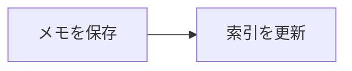

# ブロックの種類

「/」のメニューから入れられるブロックのうち、段落とリストのほかのものを説明します。

## コード

コードのブロックには、言語に合わせて色が付きます。コードの中でTabを押すと、字下げになります。

## 数式

LaTeXで数式を書けます。行の中に書くときは`$...$`、独立した行にするときは「/」の「数式」か`$$...$$`を使います。数式を表示する部品（KaTeX）は、数式を表示するときにだけ読み込みます。

## 図（Mermaid）

コードのブロックの言語を`mermaid`にすると、中身を図として表示します。「/」の「図」からも入れられます。図を押すと、元の文字を編集できます。図を描く部品（Mermaid）は、図を表示するときにだけ読み込みます。

たとえば次のように書くと、左から右へ矢印でつないだ図になります。

## コールアウト

注意や補足を目立たせる、色付きの囲みです。情報・ヒント・注意・警告の4種類があります。Markdownでは`> [!note]`の形で書けます。

## 段組み

2段組みか3段組みで、ブロックを横に並べます。空の段には「ここに書く」と薄く出ます。スマホの幅では縦に並びます。Markdownでエクスポートすると、左の段から順に、上から並べて書き出します。

## 脚注

脚注を入れると、本文に番号の印が付き、本文の下に脚注の文が並びます。Markdownでは`[^1]`の形で書けます。

## 手書き・図形

線と図形（直線・四角形・円）を描ける枠を本文に入れます。あとから描き足せ、消しゴムで線を1本ずつ消せます。線は1本ずつのデータとして持つので、2台で同時に描いても両方の線が残ります。HTMLでエクスポートすると、図として見えます。

## 埋め込み（動画・Webページ）

動画やWebページをURLで埋め込めます。メモを開いただけでは外部に接続せず、「読み込む」を押したときに初めて読み込みます。読み込むと、そのサイトにアクセスの情報（IPアドレスなど）が伝わります。

## クエリ

条件（ノートブック、タグ、キーワード、プロパティの値）に合うメモの一覧を、本文の中に出します。

## ハイライトと文字色

文字を選んで出る書式のボタンから、ハイライトと文字色を付けられます。ハイライトはMarkdownの`==文字==`で書けます。文字色はMarkdownでエクスポートすると残りません。

## 期限

チェックリストの項目に期限を付けます（[期限と通知](/organize/reminders)）。
